# Optimizers and Learning Rates, Measured

*What `optimizer.step()` does, taken apart and measured: Adam by hand, bias correction, warmup and the
update-to-weight ratio, cosine vs WSD, Muon vs AdamW, and how the best learning rate moves with width.*

[](https://colab.research.google.com/github/rahulni/Indic_LLM/blob/main/11_Optimizers_LR/optimizers_and_learning_rates.ipynb)

A gradient says which way each weight should move, but not how far. Every optimizer is a rule for the
distance. This notebook checks those rules one at a time:
- the arithmetic, by computing Adam by hand and against PyTorch's internal state
- the training effects, by small training runs that change one thing at a time against a tuned
  baseline

Every comparison is tuned on both sides and paired by seed. Every threshold used to call a result
was written down before the first measurement.

The measured run took 311 minutes on an NVIDIA GeForce RTX 3070 Laptop GPU:
- precision: bf16
- software: torch 2.11.0+cu128, Python 3.14.5
- date: 2026-10-11
- power: on AC power, Turbo power plan

The notebook opens in **learn** mode, which replays these results on a CPU in about a minute
(see [Running it](#running-it)).


## Answers at a glance

| question | measured answer | where |
|---|---|---|
| Does Adam by hand match PyTorch? | Yes. Every quantity matches the 50-digit reference to 3e-15 in float64 and 2e-08 in float32. The fused float32 kernel's v̂ is off by 3.3e-06, because it rounds 1−β2 in float32; its step agrees to 1e-08. | [§1](#1-adam-by-hand) |
| Bias correction off: when does the difference stop mattering? | The first step is **3.16×** too large, and the gap *grows* to 6.57× at step 12 (6.24× at step 20). It is within 1% only after **3,925 steps** at β2=0.999, or **76** at β2=0.95. In the 31.5M model the loss gap leaves seed noise at: β2=0.95,warmup=0: never in 300; β2=0.95,warmup=30: step 16; β2=0.999,warmup=0: never in 300; β2=0.999,warmup=30: never in 300. | [§2](#2-bias-correction), [§4](#4-bias-correction-in-a-real-model) |
| When does warmup stop changing the update-to-weight ratio? | Warmup changes the ratio from **step 1** by construction (its learning rate is smaller), so the step where it *starts* changing it is 1. Where it *stops*, compared with no warmup at all (the rule fixed in advance): warmup 6: **never in 300**; warmup 30: **never in 300**; warmup 100: **never in 300**. Skipping warmup leaves a lasting mark: the largest ratio is 2.0e-01 without warmup vs 4.3e-02 with 30 steps, and the loss never catches up. Among warmed-up runs, the warmup *length* stops mattering at step 148 (6 vs 30), 138 (30 vs 100) (exploratory). | [§5](#5-update-to-weight-ratio-and-warmup) |
| Cosine vs WSD, both stopped at 200 of 300: which to keep? | At step 200: cosine **2.7544** ± 0.0185, WSD **2.7544** ± 0.0185 (3 seeds). Tuned on its own floor, cosine's best is **no decay at all**, so up to step 200 it is the same run as WSD's flat phase, and the as-stopped losses tie exactly. Keep **WSD**: its best option within +20% compute (WSD 200 + 40-step cooldown) beats cosine's (cosine-300 continued to 240) by -0.0274 ± 0.0019. The margin shrank as cosine's floor was tuned (floor 10%: -0.104; floor 20%: -0.086; floor 50%: -0.056; floor 100%: -0.027); it never flipped. | [§6](#6-cosine-vs-wsd-stopped-at-200) |
| Best learning rate at width 4,096, and how confident? | Minima: 256: 5.6e-03, 512: 2.5e-03, 1024: 1.2e-03. The fitted slope is -1.08 (inverse-width scaling would be −1). The held-out width 2048 was predicted to within +0.10 octaves. Use **2.7e-04**, expected within 2.5e-04–2.9e-04 (the error the same fit made one octave out); confidence **high** by the stated rule, for this depth, batch and step count. | [§7](#7-learning-rate-vs-width-and-mup) |
| Tune both sides: does Muon beat AdamW here? | Tuned vs tuned: -0.2255 ± 0.0154, speedup **1.43×** (1.37–1.48× across seeds). A speedup is claimed. Against a mis-tuned AdamW the same run looks 1.59× faster. | [§M](#muon-vs-adamw), [§8](#8-tune-both-sides) |

## Decision rules, fixed before the first measurement

The notebook stores these in `results.json` and `check`s on every rerun that they have not changed.

- **bias correction stop**: The per-step multiplier (1-b1^t)/sqrt(1-b2^t) is within p of 1 for every later step. Headline p = 1%; 5% and 10% also reported. In a real model: the 20-step EMA of the paired loss gap stays inside +-2 seed s.d. from that step on.
- **warmup stop**: For each tensor, the 9-step rolling median of its update/weight ratio stays within p of the no-warmup run's ratio from that step on. Headline p = 10%; 5% and 20% for sensitivity.
- **keep at 200**: Both runs are stopped at step 200. For each, take the best finished model reachable with at most 20% more compute (cosine: its step-200 or step-240 model; WSD: its step-200 model or a 40-step cooldown from it). Keep the run whose option has the lower paired-mean validation loss. If they are within 2 paired standard errors, keep WSD, because it can still continue.
- **lr minimum**: Vertex of a parabola in log2(lr) through the five sqrt(2)-spaced points around the argmin of the seed-mean final loss. 90% interval from 2,000 bootstrap resamples over seeds.
- **confidence 4096**: High: the width-2,048 prediction is off by < 0.5 octave AND the 90% interval at 4,096 is narrower than 1 octave. Medium: off by < 1 octave. Otherwise low.
- **optimizer claim**: A speedup is claimed only if the tuned-vs-tuned paired loss difference exceeds 2 standard errors. Speedup = steps the tuned AdamW run needs to reach its final loss, divided by the steps the challenger needs to reach that same loss.

## 1. Adam by hand

One weight at w = 1, lr = 1e-3, β = (0.9, 0.999), ε = 1e-8, five gradients. The values below are the
exact (50-digit) computation:

| t | g | m | v | m̂ | v̂ | step | w |
|---|---|---|---|---|---|---|---|
| 1 | 0.50 | 0.0500 | 0.000250 | 0.5000 | 0.2500 | -0.001000 | 0.999000 |
| 2 | 0.40 | 0.0850 | 0.000410 | 0.4474 | 0.2050 | -0.000988 | 0.998012 |
| 3 | 0.60 | 0.1365 | 0.000769 | 0.5037 | 0.2567 | -0.000994 | 0.997018 |
| 4 | 0.45 | 0.1678 | 0.000971 | 0.4881 | 0.2431 | -0.000990 | 0.996028 |
| 5 | 0.55 | 0.2061 | 0.001273 | 0.5032 | 0.2550 | -0.000996 | 0.995031 |

Step by step, side by side. PyTorch's numbers are read from `optimizer.state` after each step
(float32, the default dtype). They agree with the hand computation to at least
**7 decimal places**:

| t |  | m | v | m̂ | v̂ | step |
|---|---|---|---|---|---|---|
| 1 | by hand | 0.05000000 | 0.00025000 | 0.50000000 | 0.25000000 | -0.00100000 |
|  | PyTorch | 0.05000000 | 0.00025000 | 0.50000001 | 0.25000001 | -0.00099999 |
| 2 | by hand | 0.08500000 | 0.00040975 | 0.44736842 | 0.20497749 | -0.00098813 |
|  | PyTorch | 0.08500000 | 0.00040975 | 0.44736843 | 0.20497751 | -0.00098813 |
| 3 | by hand | 0.13650000 | 0.00076934 | 0.50369004 | 0.25670337 | -0.00099414 |
|  | PyTorch | 0.13650000 | 0.00076934 | 0.50369004 | 0.25670339 | -0.00099415 |
| 4 | by hand | 0.16785000 | 0.00097107 | 0.48807793 | 0.24313218 | -0.00098985 |
|  | PyTorch | 0.16785000 | 0.00097107 | 0.48807794 | 0.24313219 | -0.00098985 |
| 5 | by hand | 0.20606500 | 0.00127260 | 0.50319895 | 0.25502952 | -0.00099642 |
|  | PyTorch | 0.20606500 | 0.00127260 | 0.50319894 | 0.25502953 | -0.00099641 |

Largest |difference| from the exact values, for each implementation. PyTorch stores m (`exp_avg`) and v (`exp_avg_sq`); m̂ and v̂
are derived from them:

| implementation | m | v | m̂ | v̂ | step | w |
|---|---|---|---|---|---|---|
| by hand, float64 | 2.8e-17 | 1.3e-18 | 1.1e-16 | 3.0e-15 | 6.9e-18 | 1.1e-16 |
| torch float64, for-loop | 2.8e-17 | 1.3e-18 | 1.1e-16 | 3.0e-15 | 5.2e-17 | 1.1e-16 |
| torch float64, foreach | 2.8e-17 | 1.3e-18 | 1.1e-16 | 3.0e-15 | 5.2e-17 | 1.1e-16 |
| torch float32, for-loop | 2.6e-09 | 7.2e-11 | 7.7e-09 | 2.2e-08 | 1.4e-08 | 1.3e-08 |
| torch float32, foreach | 2.6e-09 | 7.2e-11 | 7.7e-09 | 2.2e-08 | 1.4e-08 | 1.3e-08 |
| torch float64, fused CUDA | 5.6e-17 | 1.3e-18 | 1.7e-16 | 3.0e-15 | 5.2e-17 | 1.1e-16 |
| torch float32, fused CUDA | 4.4e-08 | 1.6e-08 | 1.2e-07 | 3.3e-06 | 1.4e-08 | 1.3e-08 |

The fused float32 kernel computes 1−β2 in float32, which is off by 1.3e-5 relative. Its own bias
correction uses the same rounded β2, so the step is unaffected. `adam_by_hand.py` runs the same check
standalone and exits 1 on any mismatch.

## 2. Bias correction

Without correction, the step is too large by exactly $(1-\beta_1^t)/\sqrt{1-\beta_2^t}$, whatever the
gradients. $m$ recovers from its zero start in tens of steps, $v$ in thousands, so the gap **widens**
over the first dozen steps before it closes.

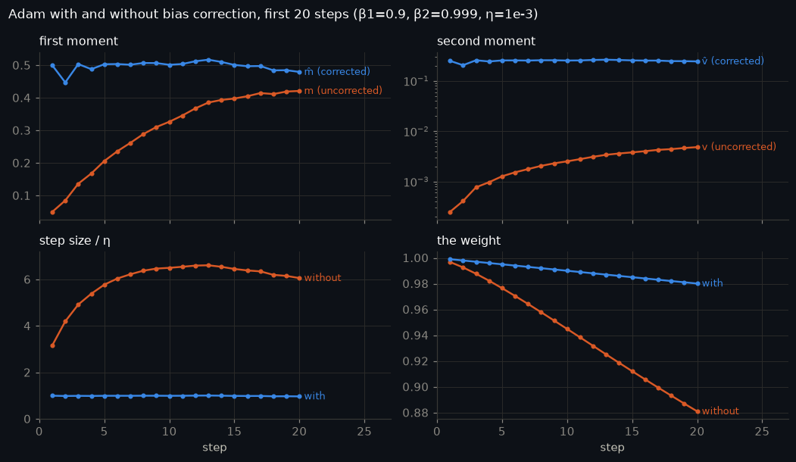

Steps until the per-step multiplier stays within 1/5/10% of 1. Only $v$'s correction matters past the
first ~44 steps.

| β2 | 1% | 5% | 10% |
|---|---|---|---|
| 0.95 | 76 | 43 | 6 |
| 0.98 | 195 | 118 | 87 |
| 0.99 | 391 | 237 | 175 |
| 0.999 | 3,925 | 2,375 | 1,751 |

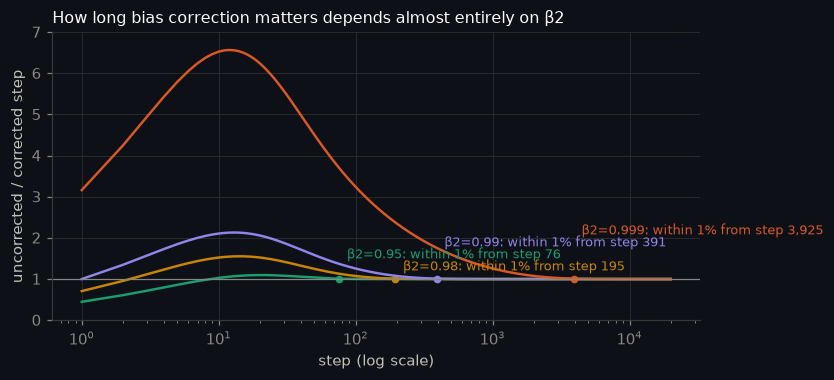

Summed over the run, the overshoot is permanent: about **1,213 η** of extra displacement at β2 = 0.999
(consistent gradients).

## 3. The testbed

All training runs use TinyStories with the SmolLM2 tokenizer:
- **Base model**, used in §4–§6 and the Muon comparison: width 384, 8 layers, grouped-query attention
  (6/2 heads), SwiGLU, RoPE, a tied 49,152-token embedding, 31.5M parameters,
  16,384 tokens per step.
- **Width family**, used in §7: 4 layers, head size 64, an 8,192-id vocabulary, untied.

Runs with the same seed start from the same weights and see the same batches, so every comparison
is paired. A hand-written AdamW, used to switch bias correction off, matches `torch.optim.AdamW` on
all 31.5M weights for 20 steps (largest difference 0).

The base model's peak learning rate is tuned on a bracketed factor-2 grid; the best is
**1e-03**:
- seed-to-seed spread of validation loss: 0.0235 s.d.
- running the same seed twice moves it by 0.00000, the GPU-nondeterminism
  floor
- untrained loss: 10.83 (ln 49,152 = 10.80)

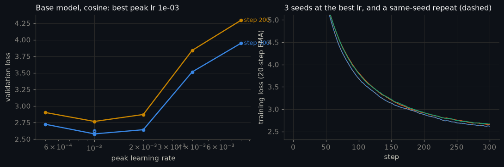

## 4. Bias correction in a real model

The 31.5M base model, 300 steps, tuned learning rate, bias correction on and off, same seed and data:

| setting | val loss, on | val loss, off | off − on | gap inside seed band from step |
|---|---|---|---|---|
| β2=0.95, warmup 0 | 3.5534 | 2.9547 | -0.5987 | never in 300 |
| β2=0.95, warmup 30 | 2.6041 | 2.6313 | +0.0272 | 16 |
| β2=0.999, warmup 0 | 3.5265 | 4.2360 | +0.7095 | never in 300 |
| β2=0.999, warmup 30 | 2.6179 | 4.5932 | +1.9753 | never in 300 |

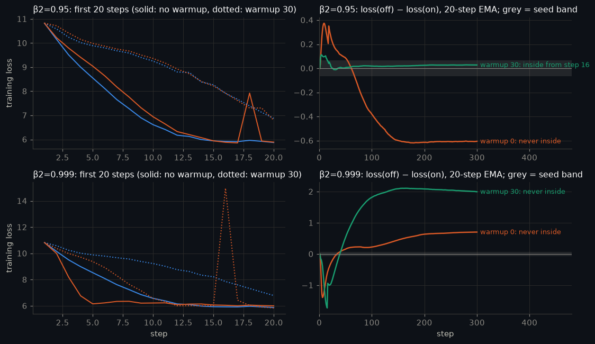

From the same optimizer state, the uncorrected/corrected update ratio of the median tensor tracks the
closed form to within 3.7%:

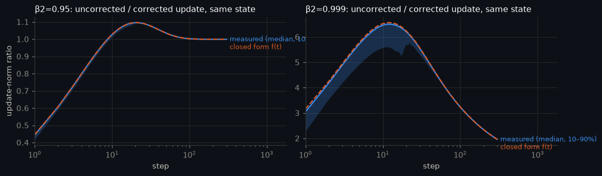

## 5. Update-to-weight ratio and warmup

Each matrix's $\lVert\Delta W\rVert/\lVert W\rVert$ is logged on every step. Runs warmed up over W steps
are compared with one that is not, at the same constant peak learning rate.

Warmup changes the ratio from step 1, because its learning rate is smaller by construction, so the
informative question is where that influence **ends**. "Warmup stops changing the ratio" is the step
after which every later step stays within the threshold of the no-warmup run (9-step rolling median,
median over matrices):

| warmup W | 5% | 10% (headline) | 20% | ratio settles by | range over matrices (10%) |
|---|---|---|---|---|---|
| 6 | never in 300 | never in 300 | never in 300 | 168 | 100–never in 300 |
| 30 | never in 300 | never in 300 | never in 300 | 159 | 110–never in 300 |
| 100 | never in 300 | never in 300 | never in 300 | 160 | 198–never in 300 |

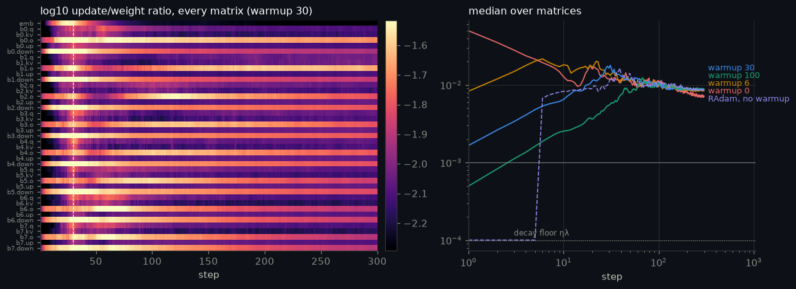

What drives the ratio:
- **Adam's step as a fraction of η** falls from 1.00 at step 1 to
  0.20 once gradients decorrelate.
- **The decay part.** Decoupled decay alone contributes ηλ = 1.0e-04 per
  step, against a late median ratio of 8.9e-03.
- **Spectral vs Frobenius.** The spectral ratio is
  1.6, 2.0, 1.7, 1.0× the Frobenius ratio, so updates
  concentrate in a few directions.
- **Updates bf16 would round away:** 19% of updates are smaller than half
  a bf16 spacing at the peak learning rate, and 80% at a 10× smaller
  one.

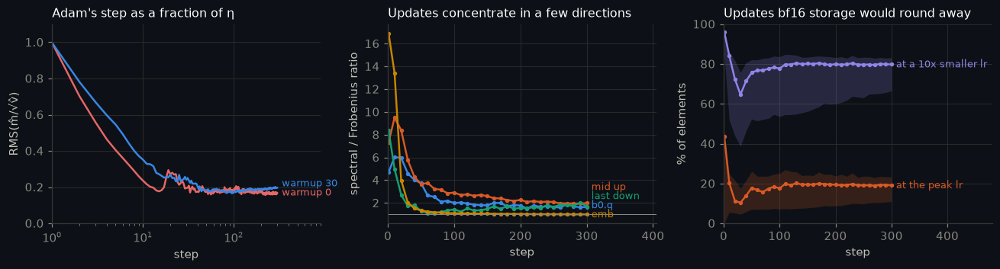

Embedding rows (tied head), median ratio by token-frequency rank:
100 most frequent 5.0e-03, rank 100–1k 7.8e-03, rank 1k–8k 6.1e-03, rank ≥ 8k (rare/unseen) 5.5e-03, in this batch 8.6e-03, not in this batch 5.5e-03.

A RAdam run with **no** warmup reaches 2.5769, against
warmup 0: 3.1002, warmup 6: 2.5163, warmup 30: 2.4540, warmup 100: 2.4345 (one seed each).

## 6. Cosine vs WSD, stopped at 200

The same model is planned for 300 steps under each schedule, and both are stopped at step 200.
Each schedule was tuned with the same trial budget ({'cosine': 15, 'WSD': 9}). The chosen variants:
- cosine: cosine, floor 100%, peak learning rate 1e-03
- WSD: WSD, last 10% linear, peak learning rate 1e-03

Cosine's floor was tuned by the same edge rule as every learning rate. It kept improving all the way
to 100%, which means no decay. So the tuned cosine arm is a constant learning rate, the same run as
WSD's flat phase, and the rows below that coincide do so because they are the same model.

Three paired seeds. Compute is in steps:

| model | compute | val loss | s.d. |
|---|---|---|---|
| cosine-300, stopped at 200 | 200 | 2.7544 | 0.0185 |
| WSD-300, stopped at 200 | 200 | 2.7544 | 0.0185 |
| cosine planned for 200 | 200 | 2.7544 | 0.0185 |
| WSD checkpoint 160 + 40-step cooldown | 200 | 2.7431 | 0.0234 |
| WSD flat phase, weight EMA 0.9 (constant lr + EMA) | 200 | 2.7169 | 0.0217 |
| cosine-300, continued to 240 | 240 | 2.6175 | 0.0136 |
| WSD checkpoint 200 + 40-step cooldown | 240 | 2.5901 | 0.0163 |
| cosine planned for 240 | 240 | 2.6175 | 0.0136 |
| cosine-300, completed | 300 | 2.4641 | 0.0091 |
| WSD-300, completed | 300 | 2.4183 | 0.0110 |

How the keep decision moved as cosine's floor was tuned (WSD's best option − cosine's best option
within +20% compute, 3 paired seeds):

| cosine floor | WSD − cosine | SE | keep |
|---|---|---|---|
| 10% | -0.1039 | 0.0050 | WSD |
| 20% | -0.0862 | 0.0039 | WSD |
| 50% | -0.0563 | 0.0018 | WSD |
| 100% | -0.0274 | 0.0019 | WSD |

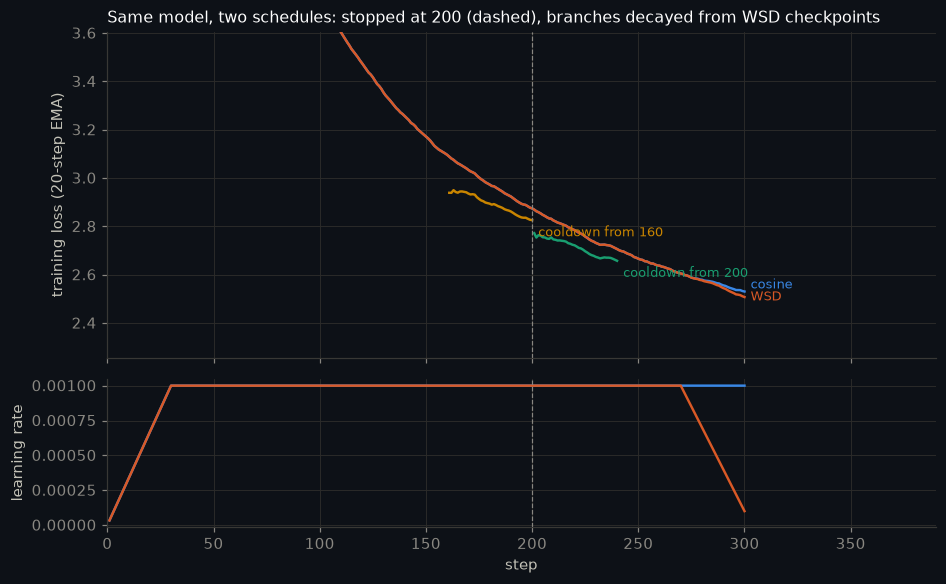

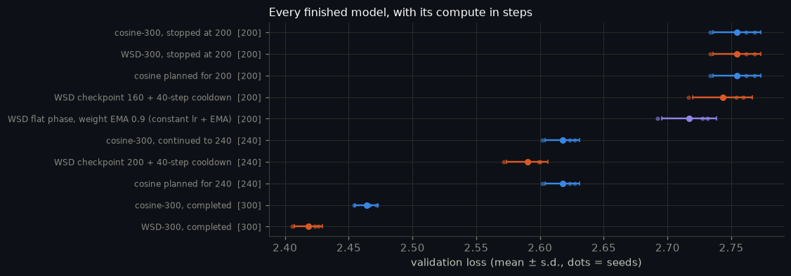

The state of each model at step 200:

|  | val loss | train loss | lr now | grad norm | clipped | update/weight |
|---|---|---|---|---|---|---|
| cosine-300 at step 200 | 2.7544 | 2.8001 | 1.0e-03 | 0.726 | 3% | 8.9e-03 |
| WSD-300 at step 200 | 2.7544 | 2.8001 | 1.0e-03 | 0.726 | 3% | 8.9e-03 |

**Decision (rule fixed in advance): keep the WSD run.**
- Best option within +20% compute: cosine → cosine-300 continued to 240, WSD → WSD 200 + 40-step cooldown.
- Paired difference WSD − cosine: -0.0274 ± 0.0019 (SE over seeds; eval-sampling SE 0.0007).
- As stopped, without any cooldown: WSD − cosine = +0.0000 ± 0.0000.

Samples at step 200 (seed 0):
- cosine: *Once upon a time, there was a little boy named Tim. Tim had a favorite toy. It loved to run and play outside. One day, Tim and his friend, Sam, came to play. It was a big mess! Tim told Sam, "*
- WSD: *Once upon a time, there was a little boy named Tim. Tim had a favorite toy. It loved to run and play outside. One day, Tim and his friend, Sam, came to play. It was a big mess! Tim told Sam, "*
- WSD 160 + cooldown: *Once upon a time, there was a little boy named Tim. Tim was a very special boy. He had many friends who loved to play with. One day, Tim found a small toy that was very small. He wanted to see what made.
Tim*

## Muon vs AdamW

Muon (momentum 0.95, Nesterov, `match_rms_adamw`) runs on the 40 hidden matrices. AdamW runs on the
embedding and norm gains. Each optimizer's learning rate was tuned on the same grid with the same
number of trials ({'adamw': 5, 'muon': 5}), and both ran on the same 3 seeds.

Tuned vs tuned:
- final loss: Muon 2.3809 vs AdamW 2.6064
- paired difference: **-0.2255 ± 0.0154**
- speedup to AdamW's final loss: 1.37×, 1.43×, 1.48×
- a speedup is claimed

The same tuned Muon run against differently tuned AdamW baselines:

| baseline | loss difference | apparent speedup |
|---|---|---|
| AdamW at 5e-04 (half its best) | -0.3436 | 1.59× |
| AdamW at 2e-03 (double its best) | -0.2618 | 1.48× |
| AdamW at its tuned lr | -0.1989 | 1.37× |

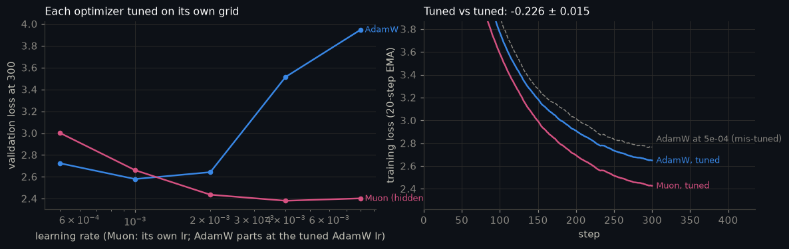

## 7. Learning rate vs width, and muP

Width family: 4 layers, head size 64, an 8,192-id vocabulary, untied. Everything except width is
fixed: a 16,384-token batch, 300 steps, warmup + cosine. Each minimum is the vertex of a parabola
in log2(lr) through five √2-spaced points with 3 seeds each, with a 90% bootstrap interval:

| width | parameters | best lr | 90% interval | loss there | cost of a 2× error |
|---|---|---|---|---|---|
| 256 | 7.2M | 5.63e-03 | 5.54e-03 – 5.73e-03 | 2.4944 | +0.0810 |
| 512 | 20.8M | 2.53e-03 | 2.48e-03 – 2.59e-03 | 2.3651 | +0.0954 |
| 1024 | 66.6M | 1.20e-03 | 1.19e-03 – 1.21e-03 | 2.2527 | +0.1079 |

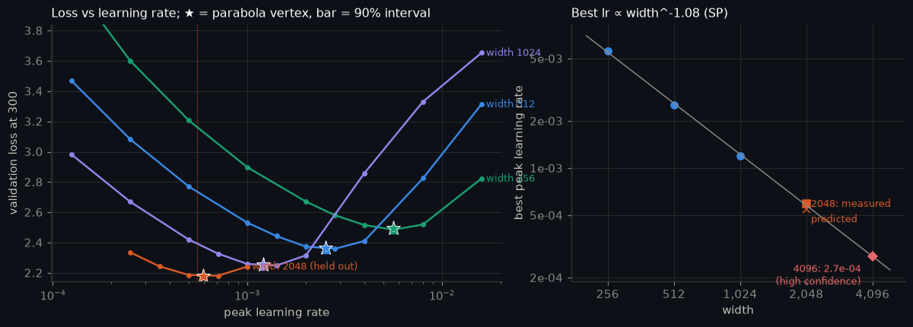

Fit and test:
- **Fit.** log2(best lr) = -1.11·log2(width) + c, slope 90% interval -1.13 to -1.10.
- **Prediction for width 2048:** 5.51e-04.
- **Measured at width 2048:** 5.92e-04, so the prediction was off by **+0.10 octaves**.
- **Refit on four widths** gives slope -1.08.

**Width 4096: use 2.7e-04.**
- **Honest band: 2.5e-04–2.9e-04.** This is the error the same fit made one octave
  out, at width 2048.
- **Bootstrap interval: 2.7e-04–2.8e-04.** It is 0.03 octaves wide but reflects seed noise only, so it
  understates the real uncertainty.
- **Confidence: high**, by the rule fixed in advance.

For comparison, scaling width 256's best by 1/width gives 3.5e-04. The answer
holds only for this depth, batch, step count and the standard parameterization. A different batch
needs the √batch adjustment.

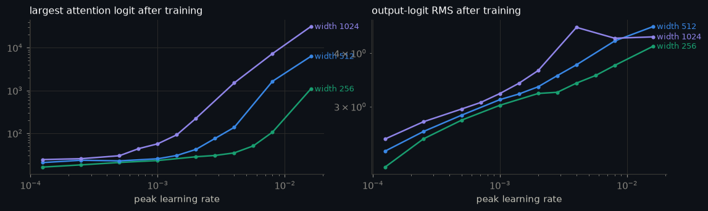

Update/weight ratio at each width's best learning rate (second half of the run):

| width | embedding | hidden matrices | output head |
|---|---|---|---|
| 256 | 5.9e-04 | 9.6e-03 | 6.4e-03 |
| 512 | 2.8e-04 | 7.8e-03 | 5.2e-03 |
| 1024 | 1.4e-04 | 5.9e-03 | 4.1e-03 |

**muP.**
- **Coordinate check.** After 10 steps at one learning rate, the logit RMS grows
  2.0× from the smallest width to 2048 under SP, against
  1.1× under muP.
- **Sweep.** The spread of the best learning rate across widths is
  2.19 octaves under SP and 0.27 under muP.

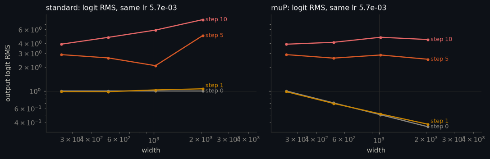

| width | muP best lr | loss |
|---|---|---|
| 256 | 5.39e-03 | 2.4951 |
| 512 | 4.77e-03 | 2.3698 |
| 1024 | 4.45e-03 | 2.2922 |

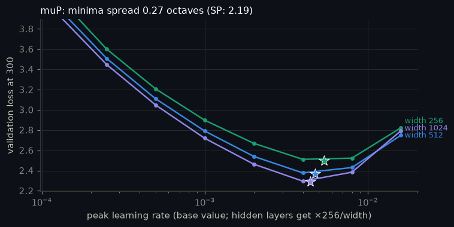

Carrying width 256's best learning rate (5.7e-03) to width 2048 unchanged
gives 3.3320 under SP and 2.2280 under muP. SP tuned at 2048 reaches 2.1804.

## 8. Tune both sides

The same tuned challenger is set against baselines run at learning rates away from their own best.
The values come from grids already measured, at seed 0. In the learning-rate grids, both schedules
use their default knobs:

| comparison | apparent advantage, fair | worst mis-tuned baseline | octaves off |
|---|---|---|---|
| WSD vs cosine (default knobs) | +0.1704 | +1.5399 | +3 |
| Muon vs AdamW | +0.1989 | +1.5684 | +3 |
| cosine vs WSD (default knobs) | -0.1704 | +1.3040 | +3 |

The baseline's own knob matters as much as its learning rate. Against cosine at its tuned floor (100%), tuned WSD is ahead by 0.0483 at step 300. Against cosine at the usual 10% default floor, the same WSD run looks 0.1739 ahead. This notebook's own first pass made that mistake: cosine's floor grid stopped at the edge (20%). Extending it by the same edge rule, all the way to no decay, shrank WSD's step-200 margin about threefold (§6).

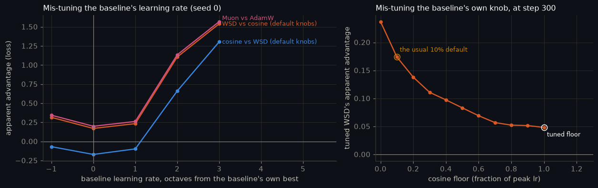

Tuning budget per side:

| comparison | trials | tuned | held fixed |
|---|---|---|---|
| cosine vs WSD | 15 vs 9 trials | lr grid + own knob, edge-extended (floor | decay length) | warmup, β, weight decay, batch, data, seeds |
| Muon vs AdamW | 5 vs 5 lr points, 3 seeds each | Muon's lr; AdamW's lr | momentum 0.95 / β (0.9, 0.95), decay 0.1, schedule |
| SP vs muP (width) | 30 vs 24 runs | lr grid per width | depth, batch, steps, schedule |

## Background figures

The notebook also covers the rules that come before Adam, each checked against standard worked numbers:
- gradient descent's stability condition, and why one learning rate cannot serve two curvatures
- momentum
- per-parameter learning rates
- optimizer memory
- the √batch rule
- Muon's orthogonalization

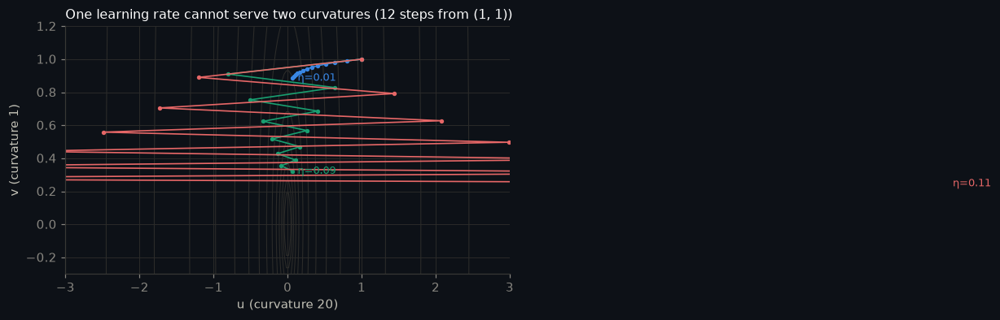
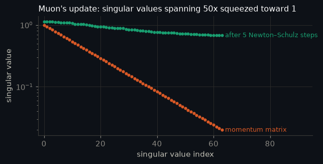
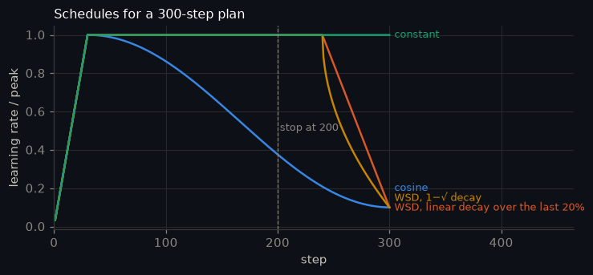

## Measured outcomes

The notebook records each of these as `observe(...)`. They are measured, not guaranteed:

- ✅ the fused kernel's v is off by 1.29e-05 relative, the same size as float32's 1 - 0.999 error
- ✅ re-running the same seed moves the validation loss less than changing the seed does
- ✅ β2=0.999 without warmup: switching bias correction off costs +0.709 in final loss (seed s.d. 0.024)
- ❌ warmup shrinks that cost to +1.975: it scales down exactly the steps the correction acts on
- ❌ β2=0.95: the final-loss difference (-0.599, +0.027) is inside seed noise
- ✅ in the real model the uncorrected/corrected update ratio follows §2's closed form (median tensor within 5%)
- ❌ for every warmup length, warmup's effect on the median matrix's ratio ends within the 300-step run
- ✅ warmup over 30 steps lowers the largest ratio from 2.00e-01 to 4.33e-02
- ✅ for every warmup length, the ratio stops being affected only after the warmup itself has ended
- ✅ Adam's step falls from 1.00 η at step 1 to 0.20 η once gradients decorrelate
- ✅ at a decayed learning rate most updates are smaller than half a bf16 spacing: without an fp32 copy they would vanish
- ✅ with a tied head, rare-token rows still move every step (the output softmax gives every row a gradient)
- ❌ as stopped at step 200, the cosine model has the lower loss
- ✅ a 40-step cooldown from WSD's step-200 checkpoint vs cosine-300 at the same compute: -0.0274 ± 0.0019
- ✅ …and vs a cosine run planned for 240 from the start: -0.0274 ± 0.0019 (within 2 SE or better)
- ✅ averaging WSD's flat-phase weights (EMA 0.9) vs a cosine run planned for 200: -0.0375 ± 0.0021 (within 2 SE or better)
- ✅ a mis-tuned AdamW baseline inflates Muon's apparent speedup from 1.37x to 1.59x
- ✅ the best achievable loss falls as width grows (wider is better at its own best learning rate)
- ✅ width 2048: the best learning rate is bracketed by the points measured around the prediction
- ✅ muP keeps the output logits flatter across width than SP does
- ✅ muP narrows the spread of best learning rates (2.19 → 0.27 octaves)
- ✅ carrying width 256's learning rate to width 2048 works better under muP than under SP
- ✅ the cosine floor is bracketed: its best value (1) is inside the values tried (0–1) or at the end of its feasible range
- ✅ the WSD decay length is bracketed: its best value (0.1) is inside the values tried (0.05–0.3)

## Limitations

- **Horizon.** 300 steps × 16,384 tokens is about 0.16 tokens per parameter for the base model, which
  is very early training. Learning-rate optima and schedule rankings shift with run length, and
  longer horizons were not tested.
- **Seeds.** Three paired seeds give 2 degrees of freedom, so differences within 2 standard errors are
  called ties.
- **Data.** There is one dataset (TinyStories).
- **Held fixed in the width sweep:** depth, batch, warmup and β.
- **muP-lite.** The muP used here rescales hidden-layer learning rates and the output multiplier only.
- **Weight decay.** ηλT ≈ 0.06, so decay barely acts within these runs.
- **Validation reuse.** The extra schedule knobs and the EMA decay were chosen on the validation set
  used for the comparison.
- **Tuned cosine is constant LR.** Cosine's best floor was 100%, so the tuned cosine arm never
  decays. The win is "decay at the end" over "no decay", and a genuine cosine decay at any floor
  loses by more.
- **Sequential tuning.** Learning rate and knob were tuned one after the other, not jointly.
- **Width 2,048** used one seed. The width-4,096 band uses that held-out error rather than the
  seed-only bootstrap.
- **Timing.** One run's wall time includes the machine sleeping, so it is excluded from the timing
  totals. Its result is unaffected.

## Running it

| `MODE` | what runs | time |
|---|---|---|
| `learn` (default) | the arithmetic sections live on a CPU; every training result is replayed from `assets/results.json` | ~1 min |
| `quick` | tiny models through every code path; writes `assets/quick/` | ~10 min on a GPU |
| `full` | every measured run | 311 min on the RTX 3070 Laptop above; a Colab T4 is roughly 2–3× slower (estimate) |

```bash
pip install -r requirements.txt
python adam_by_hand.py                                     # the hand-vs-PyTorch check on its own
python build_notebook.py                                   # nb_parts/*.py -> optimizers_and_learning_rates.ipynb
OPT_MODE=full python -m nbconvert --to notebook --execute --inplace optimizers_and_learning_rates.ipynb --ExecutePreprocessor.timeout=-1
python make_readme.py                                      # this file, from assets/results.json
```

The full run is resumable: each experiment is saved to `results.json` as soon as it finishes.
`OPT_PRECISION=fp16` rehearses the T4 path (fp16 + GradScaler) on any GPU.

| file | what it is |
|---|---|
| `optimizers_and_learning_rates.ipynb` | the notebook, executed in full mode |
| `nb_parts/` | the notebook's source, one file per section |
| `adam_by_hand.py` | a standalone Adam-by-hand vs PyTorch check |
| `build_notebook.py`, `make_readme.py` | build the notebook and this README |
| `assets/results.json` | every measured number |
| `CHEATSHEET.md` | a one-page refresher |

## References

Adam ([arXiv:1412.6980](https://arxiv.org/abs/1412.6980)) ·
AdamW ([arXiv:1711.05101](https://arxiv.org/abs/1711.05101)) ·
RAdam ([arXiv:1908.03265](https://arxiv.org/abs/1908.03265)) ·
warmup and the update/weight ratio ([arXiv:2410.23922](https://arxiv.org/abs/2410.23922)) ·
small-scale proxies for instabilities ([arXiv:2309.14322](https://arxiv.org/abs/2309.14322)) ·
μTransfer ([arXiv:2203.03466](https://arxiv.org/abs/2203.03466)) ·
spectral condition ([arXiv:2310.17813](https://arxiv.org/abs/2310.17813)) ·
scaling exponents across parameterizations ([arXiv:2407.05872](https://arxiv.org/abs/2407.05872)) ·
cooldowns and WSD ([arXiv:2405.18392](https://arxiv.org/abs/2405.18392), [arXiv:2404.06395](https://arxiv.org/abs/2404.06395), [arXiv:2410.05192](https://arxiv.org/abs/2410.05192)) ·
AdamW decay as an EMA ([arXiv:2405.13698](https://arxiv.org/abs/2405.13698)) ·
√ batch scaling ([arXiv:2205.10287](https://arxiv.org/abs/2205.10287)) ·
critical batch size ([arXiv:1812.06162](https://arxiv.org/abs/1812.06162)) ·
Muon ([blog](https://kellerjordan.github.io/posts/muon/), [arXiv:2502.16982](https://arxiv.org/abs/2502.16982)) ·
MuonClip ([arXiv:2507.20534](https://arxiv.org/abs/2507.20534)) ·
QK-norm ([arXiv:2302.05442](https://arxiv.org/abs/2302.05442)) ·
TinyStories ([arXiv:2305.07759](https://arxiv.org/abs/2305.07759)) ·
SmolLM2 ([arXiv:2502.02737](https://arxiv.org/abs/2502.02737))
